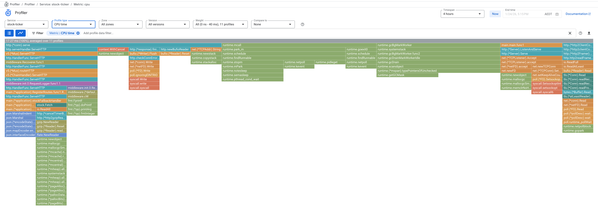
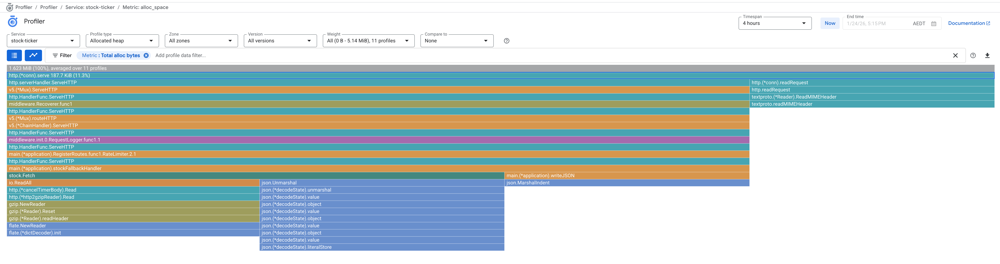

# 04 — Where does the CPU time go?

> **Time:** ~20 min · **Needs:** local run + a GCP project with the Cloud Profiler API (no cluster required) · **Cost:** negligible (Cloud Profiler is free)
>
> **Prerequisites:** [00 — Prerequisites](../00-prerequisites.md), "Local tools" and "GCP". Best read after [01 — Baseline latency](../01-baseline-latency/README.md).

## The question

A request is slow or a service burns more CPU than expected. Metrics tell you *that* it happens
and *which endpoint*; they don't tell you *which function*. A continuous profiler answers that
without attaching anything to a live process.

Flame graphs come from Brendan Gregg ([brendangregg.com/flamegraphs.html](https://www.brendangregg.com/flamegraphs.html)).
Cloud Profiler is Google's managed version: the Go agent samples the process and uploads profiles,
and the console lets you slice and compare them
([Go setup docs](https://cloud.google.com/profiler/docs/profiling-go)).

## Hypothesis

If you run `perf-lab` under load and look at its CPU profile:

- the `cpu` scenario's hash loop (`internal/scenarios/cpu.go`) should dominate the graph while
  that load runs, and
- with the load stopped, the same service should be almost entirely idle runtime and network
  polling.

## Setup

Cloud Profiler does not need the app to run in GCP. It only needs a project with the API enabled
and credentials that can write to it (`gcloud auth application-default login`).

```bash
cd workloads/perf-lab
GCP_PROJECT_ID=<your-project> ENABLE_CLOUDPROFILER=true DISABLE_RATE_LIMIT=true go run ./cmd/api
```

You should see:

```
Cloud Profiler started
Starting server on :8080
```

In the cluster, `workloads/perf-lab/k8s/configmap.yaml` already sets `ENABLE_CLOUDPROFILER=true`;
the pod's service account needs `roles/cloudprofiler.agent`.

## Run

Generate load against one scenario so there is something to see (the profiler samples at a low
rate, so give it a few minutes):

```bash
fortio load -qps 0 -c 8 -t 5m -quiet \
  'http://localhost:8080/v1/scenarios/cpu?duration=50ms&goroutines=1'
```

## What to look at

Open the [Profiler page](https://console.cloud.google.com/profiler), select the `perf-lab`
service, and look at two profile types:

1. **CPU time**: where the process spent CPU.
2. **Allocated heap**: which call paths allocated memory (drives GC pressure).

Reading a flame graph: width is share of the total, the y-axis is call depth (callers at the
bottom of the stack, callees above), colours only group packages. Look for the widest frames at
the top of a tower, not the widest frame overall: `http.(*conn).serve` is always wide because
everything runs under it.

Two useful controls: **Compare to** (e.g. the same service an hour earlier, or a different
version) and the **filter** box (`Add profile data filter`) to isolate a function or package.

## What you should see

> **TODO:** replace these screenshots with captures of `perf-lab` running the `cpu` scenario.
> The two images below are from an earlier service in this repo (`stock-ticker`, handler
> `stockFallbackHandler`), kept because they show how to read the views.

### CPU time



The tallest towers sit under the HTTP handler (JSON encoding, gzip decoding, `fmt`, and network
writes) while the Go runtime's own frames (`gcBgMarkWorker`, scheduler, `netpoll`) are a separate
set of wide bars to the right. That split of *your code* vs *runtime/GC* is the first thing to
read off any graph.

### Allocated heap



Allocation is concentrated in reading and decoding the upstream response (`io.ReadAll`, gzip,
`json.Unmarshal`) and in re-encoding with `json.MarshalIndent`. Heap allocation is what drives GC
CPU in the first graph, so the two views are often read together.

For `perf-lab` expect different shapes: the `cpu` scenario is a tight SHA-256 loop that allocates
almost nothing by design (buffers are preallocated), so its heap graph should be nearly empty
while its CPU graph is dominated by the hash loop. Verify that on your own capture.

## Why

A sampling profiler records stack traces at a fixed interval, so each frame's width is
proportional to the time the sampled goroutines spent in it. It adds little overhead, which is
why it can run continuously in production, and it complements the metrics from
[01](../01-baseline-latency/README.md): histograms localise the problem to a route, the profile
localises it to a function.

Limits worth knowing: CPU profiles show where CPU was *used*, not where requests *waited*. A
request that is slow because it was queued for a core (the 32-connection run in tutorial 01) shows
up in the profile as nothing special. Waiting is visible in the run-queue latency tutorials later
in the series.

## Clean up

Stop the server with Ctrl-C. Profiles are retained by the service; nothing to delete.

## Tested on

The screenshots were captured 2026-01-24 against the earlier `stock-ticker` service. The commands
above reflect the current `perf-lab` configuration (`ENABLE_CLOUDPROFILER`, `GCP_PROJECT_ID`,
`DISABLE_RATE_LIMIT`) but have not been re-run against a live GCP project since the move.

## Next

Later in the series: tracing the scheduler with bpftrace, and measuring run-queue latency per
cgroup with eBPF.
